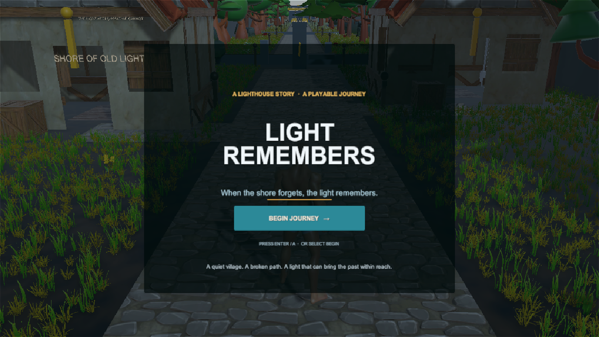
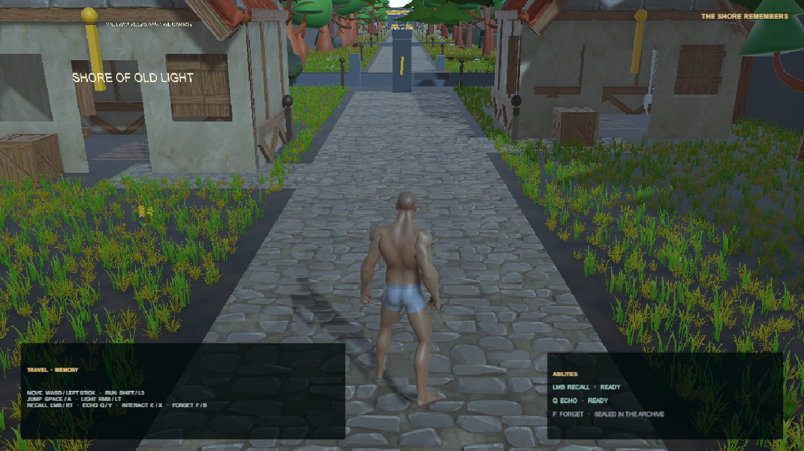
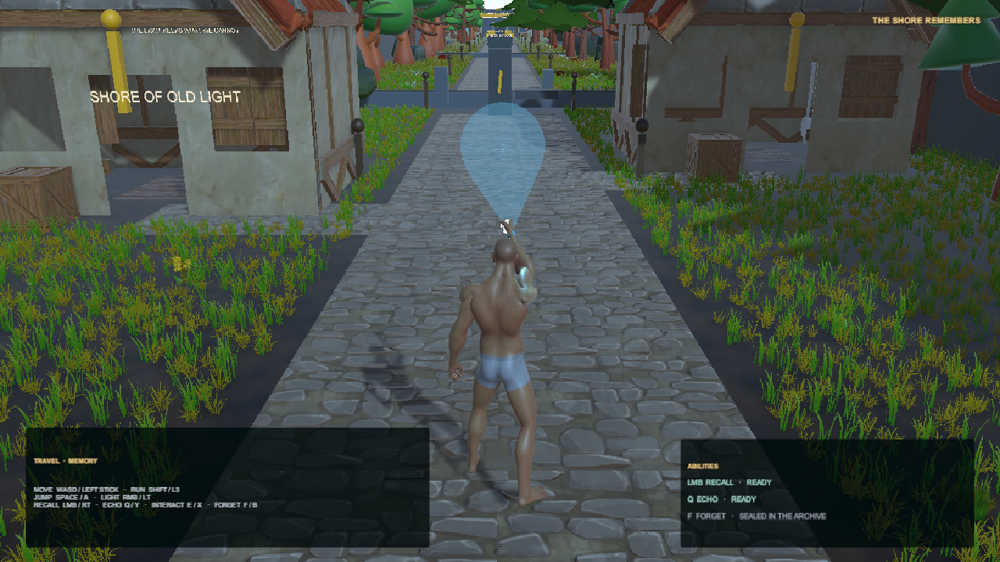

# Light Remembers

> When the shore forgets, the light remembers.

**Light Remembers** is a third-person exploration and environmental-puzzle prototype built with Unity 6 and URP. The player uses light to uncover fragments of the past and bring remembered places and movements back into the world.

## In-game screenshots

### Start screen

### The lighthouse journey

### Memory Light

## The memory language

- **Memory Light** reveals memories in the environment and exposes their targets.
- **Recall** restores a ruined object to its remembered physical form for a limited time.
- **Echo** replays remembered movement, such as a ferry or a moving platform.
- **Forget** releases selected memories and is part of the later encounter prototypes.

The lighthouse journey combines traversal, environmental storytelling, a small village, and the game's core memory interactions. The Hollow encounter explores defensive use of Memory Light and safe recovery. These are prototype systems and graybox gameplay, not a claim that the game is production-complete.

## Play the showcase

1. Open the project with **Unity 6000.6.5f1**.
2. Open `Assets/_Game/Scenes/Prototype/LighthouseJourney.unity` (it is the first enabled scene in Build Settings).
3. Press **Play**, then choose **Begin Journey** on the title screen.

## Controls

| Action | Keyboard / mouse | Gamepad |
| --- | --- | --- |
| Move | WASD | Left stick |
| Look | Mouse | Right stick |
| Run | Left Shift | L3 |
| Jump | Space | A |
| Hold Memory Light | Right mouse button | Left trigger |
| Recall | Left mouse button | Right trigger |
| Echo | Q | Right bumper (RB / R1) |
| Interact | E | X |
| Forget | F | Right-stick press (R3) |

## Prototype scenes

All project-owned Unity content lives under `Assets/_Game`.

- `LighthouseJourney` — opening presentation and village journey.
- `BoathousePrototype` — the broken bridge and early Recall test.
- `OldLight01` and `OldLight02` — chamber puzzles and the ferry/lift sequence.
- `LighthouseApproach01` — the combined Recall + Echo traversal puzzle.
- `HollowEncounter01` — the defensive Hollow encounter and remnant recovery.
- `ForgetPrototype` — Forget ability and consequence tests.

## Project notes

- **Engine:** Unity 6000.6.5f1
- **Rendering:** Universal Render Pipeline (URP)
- **Language:** C#
- **Input:** Unity Input System
- **Root namespace:** `LightRemembers`

Third-party asset inventory and usage notes are in [`Assets/ThirdParty/ASSET_CATALOG.md`](Assets/ThirdParty/ASSET_CATALOG.md). Supplied license summaries are in [`Assets/ThirdParty/LICENSES.md`](Assets/ThirdParty/LICENSES.md); the original license files remain alongside their assets.
